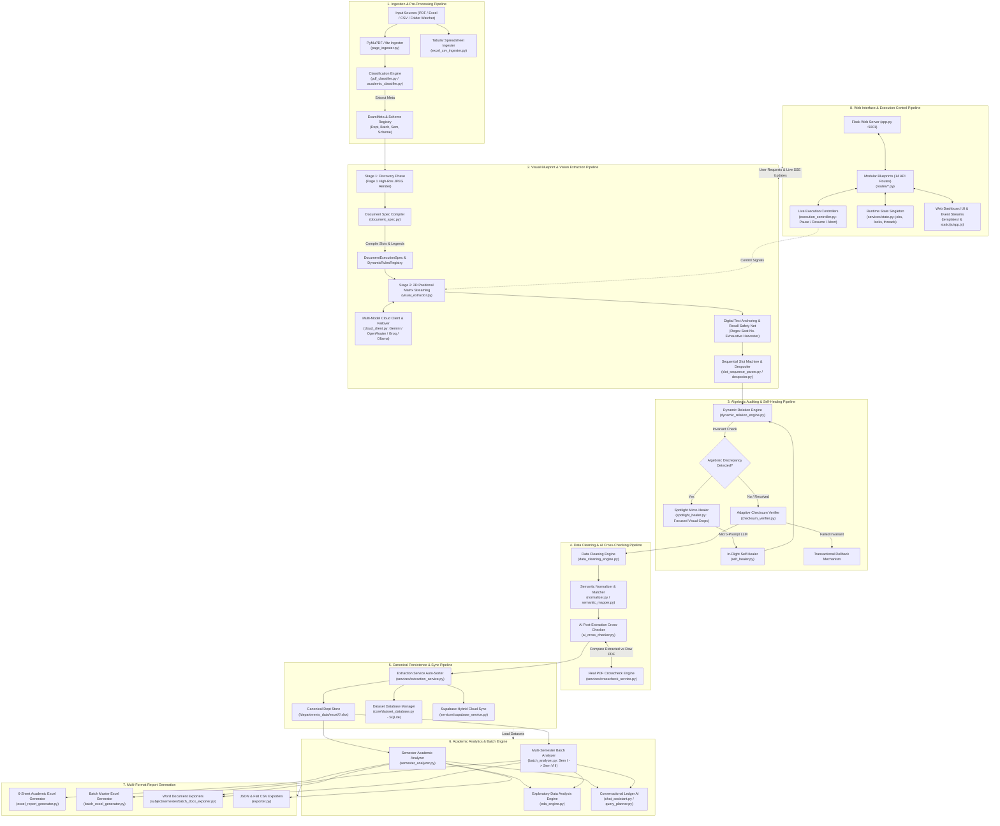
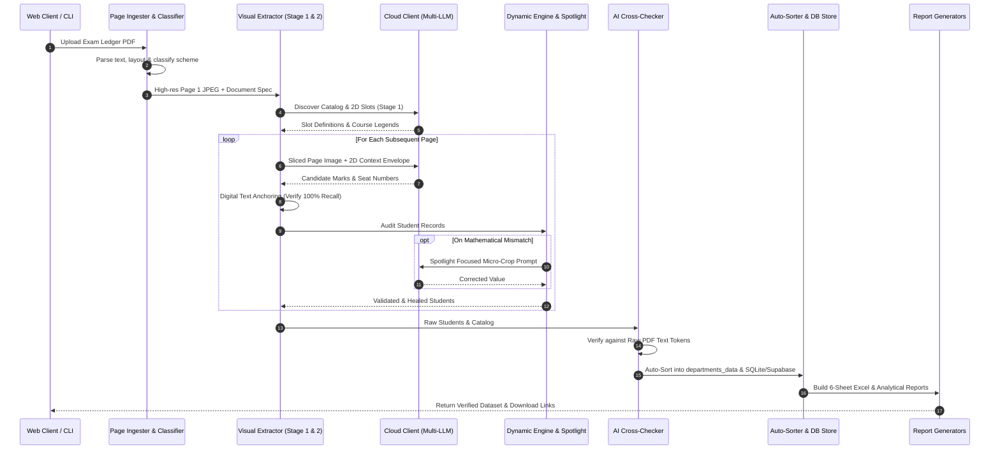

# Absolute System Test & Pipeline Verification Specification
## `data_extractor_AI` (Data Extractor & Analyzer)

---

## 1. Executive Summary & Verification Mission

The **Data Extractor & Analyzer** (`data_extractor_AI`) is an enterprise-grade academic ledger extraction, normalization, and statistical analysis platform. It translates unstructured, multi-format university examination result PDFs (CBCGS, C-Scheme, NEP 2020) and tabular spreadsheets into algebraically verified datasets, 6-sheet analytical Excel workbooks, multi-semester longitudinal cohort models, and interactive conversational queries.

### The Zero-Defect Mandate
Academic records carry legal, professional, and institutional significance. A single dropped student, miscalculated grade point, or shifted elective column invalidates institutional rankings, accreditation audits, and student transcripts. Consequently, the test harness must enforce:
1. **100% Student Recall Guarantee**: 0% false negatives in candidate extraction regardless of ledger length or page splits.
2. **Deterministic Algebraic Invariance**: Exact arithmetic compliance across all assessment heads ($\text{Theory} + \text{Internal} = \text{Total}$), grade points ($\text{Credits} \times \text{GP} = \text{CG}$), and credit weighted averages ($\sum \text{CG} / \sum \text{Credits} = \text{SGPI}$).
3. **Resilient Multi-Tier Cloud Failover**: Seamless provider switching (Google Gemini $\rightarrow$ OpenRouter $\rightarrow$ Groq $\rightarrow$ Local Ollama) without token drift or context fragmentation.
4. **End-to-End Pipeline Cohesion**: Flawless data handoff from PDF ingestion through visual blueprint discovery, 2D matrix streaming, spotlight self-healing, cross-checking, tabular ingestion, batch progression, database synchronization (SQLite + Supabase), to multi-format document generation.

---

## 2. Global Pipeline Architecture & Interconnection Flow

The platform is structured into **8 interconnected pipelines**. Below is the comprehensive architectural dataflow illustrating how every component, service, background worker, and database interacts.



---

## 3. Subsystem Breakdown & Functional Responsibilities

| Subsystem | Source Modules | Functional Responsibility |
|---|---|---|
| **Ingestion & Classifier** | `page_ingester.py`, `pdf_classifier.py`, `academic_classifier.py`, `folder_watcher.py` | High-fidelity PDF rendering (fitz), layout geometry mapping, automatic directory polling, academic scheme/branch/semester taxonomy classification. |
| **Vision Extractor** | `visual_extractor.py`, `document_spec.py`, `slot_sequence_parser.py`, `despooler.py` | Stage 1 visual blueprint discovery, 2D positional matrix streaming, elective course slot resolution, despooling ledger lines. |
| **Cloud AI & Failover** | `cloud_client.py`, `ollama_client.py`, `prompt_builder.py` | Multi-LLM vision queries with exponential rate-limit backoff, token tracking, intelligent model park/unpark, anti-thrashing cooldowns. |
| **Auditing & Self-Healing** | `dynamic_relation_engine.py`, `spotlight_healer.py`, `self_healer.py`, `checksum_verifier.py` | Algebraic verification of student marks, focused visual crop micro-prompts for discrepancy resolution, transactional rollbacks. |
| **Cleaning & Cross-Check** | `data_cleaning_engine.py`, `normalizer.py`, `semantic_mapper.py`, `ai_cross_checker.py` | Text normalization, alias resolution, cross-referencing extracted Excel against raw PDF text and visual tokens. |
| **Persistence & State** | `dataset_database.py`, `supabase_service.py`, `state.py`, `extraction_service.py` | SQLite local database management, Supabase cloud sync, thread-safe job tracking, canonical file placement. |
| **Academic Analytics** | `semester_analyzer.py`, `batch_analyzer.py`, `eda_engine.py`, `chat_assistant.py` | Cohort pass rates, bottleneck subject detection, longitudinal KT/backlog tracking, CGPI growth curves, natural language ledger querying. |
| **Report Exporter** | `excel_report_generator.py`, `batch_excel_generator.py`, `*_docx_exporter.py`, `exporter.py` | Production of 6-sheet university-standard workbooks, batch Excel matrices, formatted Word evaluation reports, CSV/JSON dumps. |
| **Web & Control API** | `app.py`, `routes/*.py`, `execution_controller.py`, `auth_service.py` | Multi-blueprint routing, real-time SSE progress, session security, pause/resume/abort live thread controls. |

---

## 4. Comprehensive Unit Test Specifications

Unit tests must isolate each component using mocks for external dependencies (PyMuPDF, Cloud APIs, Network, File I/O, SQLite/Supabase).

### 4.1 Ingestion, Classification & Layout Mapping
- **UT-ING-01: High-DPI Page Rendering**
  - *Target*: `core.page_ingester.ingest_pdf`, `core.visual_extractor.render_page_as_jpeg`
  - *Input*: Valid multi-page PDF ledger.
  - *Assertions*: Verify output is valid JPEG binary bytes; dimensions match specified DPI (100, 150, 200); out-of-range page indices raise `IndexError` gracefully without memory leaks.
- **UT-ING-02: Branch & Semester Taxonomy Classifier**
  - *Target*: `core.pdf_classifier.normalize_department`, `normalize_semester`, `normalize_batch`
  - *Test Variations*:
    - `"COMPUTER ENGINEERING SEMESTER - IV (CBCGS)"` $\rightarrow$ Dept: `Computer Engineering`, Sem: `Sem_IV`, Scheme: `CBCGS`
    - `"ARTIFICIAL INTELLIGENCE & DATA SCIENCE SEM VII (C-SCHEME)"` $\rightarrow$ Dept: `Artificial Intelligence and Data Science`, Sem: `Sem_VII`
    - `"MECHANICAL ENGG SEM 3 NEP-2020"` $\rightarrow$ Dept: `Mechanical Engineering`, Sem: `Sem_III`, Scheme: `NEP 2020`
  - *Assertions*: Output strings strictly match canonical slugs; variations with roman numerals vs digits resolve identically.
- **UT-ING-03: Folder Watcher Debouncing & Event Triggering**
  - *Target*: `core.folder_watcher.FolderWatcher`
  - *Test*: File created in watched directory, followed by immediate rapid writes (simulating file transfer).
  - *Assertions*: Watcher debounces event until file lock is released; does not trigger duplicate extraction jobs.

### 4.2 Document Execution Spec & Dynamic Rules Registry
- **UT-SPEC-01: Master Catalog & Dynamic Slot Compilation**
  - *Target*: `core.document_spec.compile_document_spec`, `CourseSlot`
  - *Input*: Stage 1 raw discovery dictionary containing 8 courses, elective branches (`Elective-I: AI vs Cyber`), and mixed assessment heads (`[TH, IA, TOT]` and `[TW, PR, TOT]`).
  - *Assertions*: All physical column slots (1..N) mapped to unique slot IDs; elective variants grouped under identical positional coordinates; credit allocations accurately captured.
- **UT-SPEC-02: Grading Contract Scale Resolution**
  - *Target*: `core.document_spec.GradingContract`
  - *Input*: Grade scales for 10-point systems (`O: 10, A: 9, B: 8, C: 7, D: 6, P: 4, F: 0`).
  - *Assertions*: Unknown grades (`E`, `AB`, `NULL`, `--`) trigger mapped exceptions or designated sentinel values without throwing unhandled exceptions.

### 4.3 Cloud AI Client, Fallback & Failover Mechanics
- **UT-CLD-01: Primary Provider Success & Token Accounting**
  - *Target*: `core.cloud_client.CloudClient.query_vision_model`
  - *Mock*: Gemini API returns valid JSON candidate list.
  - *Assertions*: Returns parsed response; active model remains Gemini; token metrics increment accurately.
- **UT-CLD-02: 429 Rate-Limit Cooldown & Instant Failover**
  - *Target*: `core.cloud_client.CloudClient`
  - *Mock*: Gemini responds with HTTP 429 (Resource Exhausted).
  - *Assertions*: Gemini enters exponential cooldown backoff (60s $\rightarrow$ 120s $\rightarrow$ 240s); client immediately dispatches request to OpenRouter vision model; zero dropped requests.
- **UT-CLD-03: Groq / Ollama Local Fallback on Complete Cloud Outage**
  - *Target*: `core.cloud_client.CloudClient`
  - *Mock*: Gemini and OpenRouter both return HTTP 500 / 404.
  - *Assertions*: Falls back to local Ollama / Groq candidate; logs warning; preserves request envelope.
- **UT-CLD-04: Anti-Thrashing Cooldown Expiry**
  - *Target*: `core.cloud_client.CloudClient.is_model_cooling`
  - *Test*: Fast-forward system time past cooldown duration.
  - *Assertions*: Cooled model returns to active pool; backoff level resets upon successful request.

### 4.4 Dynamic Relation Engine & Mathematical Invariants
- **UT-DRE-01: Component Additivity Invariant**
  - *Target*: `core.dynamic_relation_engine.DynamicRelationEngine.audit_and_heal_student`
  - *Input*: Course result with $\text{TH} = 45$, $\text{IA} = 15$, $\text{TOT} = \text{missing}$.
  - *Assertions*: $\text{TOT}$ auto-calculated as $60$; discrepancy logged as `MISSING_AUTO_RESOLVED`.
- **UT-DRE-02: Credit Point Multiplication Invariant**
  - *Target*: `core.dynamic_relation_engine.DynamicRelationEngine`
  - *Input*: Course with $\text{Credits} = 3.0$, $\text{GP} = 8.0$, $\text{CG} = \text{missing}$.
  - *Assertions*: $\text{CG}$ auto-calculated as $24.0$; discrepancy logged and verified.
- **UT-DRE-03: Semester Total Credits & Total CG Aggregation**
  - *Target*: `core.dynamic_relation_engine.DynamicRelationEngine`
  - *Input*: Student with 6 subjects, total credits $= 20.0$, total $\text{CG} = 160.0$.
  - *Assertions*: Correctly validates $\sum \text{Credits} = 20.0$, $\sum \text{CG} = 160.0$, and computed $\text{SGPI} = 8.00$.
- **UT-DRE-04: Hallucinated Marks Rejection & Transactional Rollback**
  - *Target*: `core.visual_extractor.align_and_heal_student`
  - *Input*: Model hallucinates $\text{TH} = 78$, $\text{IA} = 19$, $\text{TOT} = 42$ (impossible sum).
  - *Assertions*: Engine detects algebraic conflict; triggers self-healing; if unresolved, preserves raw flag and rejects corrupted total.

### 4.5 Spotlight Micro-Healer
- **UT-SPT-01: Bounding-Box Micro-Crop Precision**
  - *Target*: `core.spotlight_healer.SpotlightHealer.crop_discrepancy_area`
  - *Input*: Discrepancy detected at Course Slot 3, Page 2.
  - *Assertions*: Bounding box coordinates calculated with padding; returns cropped JPEG buffer restricted to problematic cell; does not re-render entire page.
- **UT-SPT-02: In-Flight Micro-Correction Integration**
  - *Target*: `core.spotlight_healer.SpotlightHealer.heal_student_discrepancies`
  - *Mock*: Vision model heals cropped cell from "4?" to "47".
  - *Assertions*: Student record updated; algebraic invariant re-checked; audit trail appended with `HEALED_VIA_SPOTLIGHT`.

### 4.6 Data Cleaning Engine & Semantic Normalizer
- **UT-CLN-01: Unicode Sanitization & Gender Extraction**
  - *Target*: `core.normalizer.normalize_student_name`
  - *Input*: `"/DOE JANE SMITH"`, `"DOE JOHN  "`, `"DOE /MARY (PROVISIONAL)"`.
  - *Assertions*:
    - Leading `'/'` correctly sets `Gender = 'F'` and is stripped from canonical name: `"DOE JANE SMITH"`.
    - Absence of `'/'` sets `Gender = 'M'`.
    - Extra whitespace and parenthetical status tags parsed cleanly.
- **UT-CLN-02: Course Code & Head Alias Mapping**
  - *Target*: `core.normalizer.are_fields_alias_equivalent`, `normalize_head`
  - *Input*: Mismatches like `"THEORY"` vs `"TH"`, `"INTERNAL"` vs `"IA"`, `"TERM WORK"` vs `"TW"`, `"ORAL"` vs `"PR/OR"`.
  - *Assertions*: Equivalent aliases resolve to canonical head keys; distinct heads remain separated.

### 4.7 Persistence & Database Synchronization
- **UT-DB-01: SQLite Dataset Creation & Idempotent Upsert**
  - *Target*: `core.dataset_database.save_dataset_to_db`, `get_dataset_from_db`
  - *Input*: Complete dataset with 120 student records and course catalog.
  - *Assertions*: Schema tables (`datasets`, `students`, `courses`, `grades`) created if absent; records inserted; re-saving same dataset updates records without key collision errors.
- **UT-DB-02: Supabase Hybrid Sync Failover**
  - *Target*: `services.supabase_service.SupabaseService`
  - *Mock*: Cloud Supabase client throws connection error / timeout.
  - *Assertions*: System falls back to local SQLite database; queues offline sync marker; returns successful operational response to caller.

### 4.8 Academic Analytics & Batch Progression
- **UT-ANA-01: Semester Cohort Statistical Metrics**
  - *Target*: `core.semester_analyzer.SemesterAcademicAnalyzer.compute_metrics`
  - *Input*: Cohort of 100 students (80 Pass, 15 Fail/KT, 5 Absent).
  - *Assertions*: Total appeared $= 95$; pass percentage $= (80 / 95) \times 100 = 84.21\%$; Toppers list sorted descending by SGPI, then Total Marks.
- **UT-ANA-02: Multi-Semester Batch KT & Backlog Tracking**
  - *Target*: `core.batch_analyzer.BatchAcademicAnalyzer.analyze_batch`
  - *Input*: Datasets for Sem III, Sem IV, Sem V with recurring student seat numbers.
  - *Assertions*: Identifies cleared vs live backlogs; computes cumulative CGPI progression; handles student lateral entry (Direct Second Year admissions).

### 4.9 Report Exporters (Excel, DOCX, CSV)
- **UT-EXP-01: 6-Sheet Academic Excel Workbook Generation**
  - *Target*: `core.excel_report_generator.generate_academic_excel_report`
  - *Input*: Extracted student records and catalog.
  - *Assertions*:
    - Generates valid `.xlsx` file containing exactly 6 sheets: `Summary`, `Course Statistics`, `Component Analytics`, `Toppers List`, `SGPI Distribution`, `Detailed Student Ledger`.
    - Double-identifier headers formatted correctly.
    - OpenPyXL formulas and cell background colors comply with university standards.
- **UT-EXP-02: Word Document Generation Without Style Corruption**
  - *Target*: `core.semester_docx_exporter.generate_semester_docx_report`
  - *Input*: Semester analytical report summary.
  - *Assertions*: Generates valid `.docx` document; tables formatted with explicit column widths; headers and footers intact.

### 4.10 Web Routing & Live Execution Control
- **UT-WEB-01: Route Authentication & Role Enforcement**
  - *Target*: `routes.auth_api.login`, `routes.views.*`
  - *Assertions*: Unauthenticated requests redirect to `/login`; invalid credentials return 401; valid credentials establish secure session.
- **UT-WEB-02: Live Execution Controller Pause / Resume / Abort**
  - *Target*: `core.execution_controller.ExtractionController`
  - *Test*: Worker thread running simulated multi-page loop:
    1. Signal `pause()` $\rightarrow$ Worker blocks at page boundary.
    2. Signal `resume()` $\rightarrow$ Worker resumes execution.
    3. Signal `abort()` $\rightarrow$ Worker terminates immediately, cleans up temp files, and marks job `ABORTED`.

---

## 5. Comprehensive Integration Test Specifications

Integration tests verify data handoffs and contract integrity across boundaries.



### 5.1 Pipeline Contract Verification Matrix
- **INT-01: Stage 1 Blueprint $\rightarrow$ Stage 2 Streaming Contract**
  - *Test*: Feed multi-page PDF with 10 subjects. Stage 1 compiles `DocumentExecutionSpec`. Stage 2 processes Pages 2 to 5.
  - *Verification*: Ensure no slot drifting occurs; column indices in Page 5 match Page 1; elective courses (e.g. Elective-I) maintain identical slot positions across pages.
- **INT-02: Mid-Stream Cloud Provider Failover with Zero Token Drift**
  - *Test*: Start extraction of 10-page document on Gemini. Inject mock 429 rate-limit at Page 4.
  - *Verification*: `CloudClient` automatically fails over to OpenRouter; Page 4 and subsequent pages continue processing; Stage 1 Context Envelope preserved; extraction finishes with 100% student records intact.
- **INT-03: Dynamic Relation Engine $\rightarrow$ Spotlight Micro-Healer Loop**
  - *Test*: Inject simulated OCR noise into student marks on Page 3 ($\text{TH} = 32$, $\text{IA} = 14$, but extracted $\text{TOT} = 86$).
  - *Verification*: Dynamic Relation Engine flags discrepancy; passes cell coordinates to `SpotlightHealer`; spotlight crops cell, queries vision model, receives correct total $46$; audit report logs resolution; checksum verifier passes student.
- **INT-04: Auto-Sorter Canonical File Placement & SQLite Ingestion**
  - *Test*: Complete extraction of `"COMPUTER ENGINEERING SEM IV MAY 2024"`.
  - *Verification*:
    - Output `.xlsx` written to `departments_data/excel/Computer_Engineering/Batch_2022_2026/Semester_IV.xlsx`.
    - SQLite database `academic_records.db` receives dataset row, student records, and grade rows.
    - All foreign keys (`dataset_id`, `student_id`) resolve cleanly.
- **INT-05: AI Cross-Checker vs Real PDF Discrepancy Reconciliation**
  - *Test*: Post-extraction step triggers `run_ai_cross_check` on extracted Excel and original PDF.
  - *Verification*: Compares digital text stream tokens with Excel values; identifies any off-by-one seat numbers or inverted theory/internal marks; writes reconciled corrections.
- **INT-06: Tabular Ingester $\rightarrow$ Batch Progression Longitudinal Sync**
  - *Test*: Ingest 4 separate semester Excel files (Sem I to IV) via `TabularIngester`. Trigger `BatchAcademicAnalyzer`.
  - *Verification*: Students matched across semesters via seat number and name; KT backlogs identified in Sem II that were cleared in Sem III; longitudinal CGPI trend calculated without data loss.

---

## 6. End-to-End (E2E) System Test Scenarios

### E2E-01: Standard CBCGS Semester Examination Ledger
- **Dataset**: Official Mumbai University CBCGS Semester VI Engineering PDF (45 pages, ~250 students).
- **Execution**: Full execution via UI upload with `pipeline_mode="visual_blueprint"`.
- **Validation Criteria**:
  1. Discovery identifies all 6 theory courses, 4 labs, and 1 mini-project.
  2. Exactly 250 candidate seat numbers discovered and 250 `StudentRecord` objects returned (100% recall).
  3. 0 algebraic violations across all courses ($\text{TH} + \text{IA} = \text{TOT}$).
  4. SGPI calculated matches university printed SGPI to $\pm 0.01$.
  5. 6-sheet Excel generated and validated against OpenPyXL parser.
  6. SQLite and Supabase stores synchronized.

### E2E-02: NEP 2020 Multi-Head Grading Ledger
- **Dataset**: NEP 2020 Semester II Examination PDF with Major, Minor, VSEC, AEC, and IKS courses having disparate credit weights ($4.0, 3.0, 2.0, 1.0$) and letter grades.
- **Execution**: Run with local/cloud fallback enabled.
- **Validation Criteria**:
  1. Multi-head credits properly assigned per course category.
  2. Total credits sum to semester ceiling ($20$ or $22$ credits).
  3. Grade points conform to NEP 10-point scale.
  4. Analytics view displays component-wise theory vs practical breakdown.

### E2E-03: Tabular Excel/CSV Bulk Upload & Batch Report Generation
- **Dataset**: 8 separate Excel semester sheets for Batch 2020–2024.
- **Execution**: Uploaded via `/api/tabular/upload` and processed through `/api/batch/analyze`.
- **Validation Criteria**:
  1. Auto-sorted into canonical directory tree.
  2. Batch analyzer aggregates student progression across all 8 semesters.
  3. Batch master Excel generated with longitudinal student ledger.
  4. Department-level DOCX summary generated cleanly.

### E2E-04: Conversational AI Ledger Query Execution
- **Dataset**: Extracted Semester V dataset loaded in active session.
- **Execution**: Send queries to `/api/chat/query`:
  - Query 1: *"Who scored the highest marks in Computer Networks?"*
  - Query 2: *"List all female students who failed in Applied Mathematics."*
  - Query 3: *"What is the overall pass percentage of the class?"*
- **Validation Criteria**:
  1. `QueryPlanner` identifies correct target columns and filter conditions.
  2. Responses match ground-truth dataset calculations with exact student names and seat numbers.

---

## 7. Edge Cases, Chaos & Adverse Conditions Matrix

The system must handle every operational irregularity gracefully without crashing or corrupting data.

| ID | Adverse Condition / Edge Case | Failure Mode Without Defense | Required System Defense & Verification Test |
|---|---|---|---|
| **EC-01** | **Scanned / Rotated / Skewed PDF** | Layout mapper misidentifies columns; OCR failure. | `page_ingester` detects orientation; applies Deskew filter; falls back to OCR visual blueprint. |
| **EC-02** | **Student Split Across Page Boundary** | Half of student's marks on Page $N$, remainder on Page $N+1$. | `SequentialSlotMachine` detects unclosed candidate record; buffers across page boundary until seat number terminator. |
| **EC-03** | **Elective Course Branching in Same Slot** | Students have different subjects in Column 4 (e.g. Cloud vs AI). | Dynamic Rules Registry links multiple subject codes to Slot 4; matches student elective code dynamically. |
| **EC-04** | **Candidate Withheld / Absent / Null** | Marks listed as `"ABS"`, `"NULL"`, `"--"`, `"EXM"`. | Normalizer maps to standard status flags; credits earned set to $0$; arithmetic engine excludes from mark sums. |
| **EC-05** | **Gender Misidentification** | Female candidates without explicit prefix labeled incorrectly. | Strict normalization rule: leading slash (`/`) unconditionally denotes Female (`F`), absence denotes Male (`M`). |
| **EC-06** | **Dropped Candidate in LLM Response** | Visual LLM omits 1 student from Page 3 due to token limit. | Digital Text Anchoring cross-checks candidate seat regex on raw PDF page; flags missing candidate; triggers page-level recovery. |
| **EC-07** | **Zero Marks / Exemption / Condonation** | Student has $0$ marks in Theory but passes on Grace Marks (`*` or `#`). | Regex cleans grace symbols (`*`, `#`, `@`); stores raw grace in metadata; calculates valid numeric grade. |
| **EC-08** | **High Concurrency / Simultaneous Jobs** | Multiple users upload 100-page ledgers simultaneously. | Thread-safe locks (`jobs_lock`, `batch_jobs_lock`, SQLite WAL mode) prevent race conditions and file lock contention. |
| **EC-09** | **User Aborts Job Mid-Stream** | User clicks "Cancel" during Page 15 of 30. | `ExtractionController` catches abort flag; terminates background thread cleanly; removes partial temp files; sets status `ABORTED`. |
| **EC-10** | **Cloud API Outage & Network Cutoff** | Complete internet drop during multi-page stream. | `CloudClient` retries with exponential backoff; parks cloud models; alerts user via SSE; pauses job gracefully. |
| **EC-11** | **Corrupted / Empty PDF / Password Protected** | User uploads 0-byte file or encrypted PDF. | Pre-check validates file header; returns clear HTTP 400 error before spawning worker threads. |
| **EC-12** | **Extreme Ledger Size (100+ Pages, 1500+ Students)** | Memory exhaustion (OOM), excessive token costs. | Sliced page-by-page streaming releases JPEG memory after each page; 2D matrix keeps tokens at ~4,680/page. |
| **EC-13** | **Path Traversal & Script Injection in Names** | Student name contains `../../` or `<script>` tags. | Input sanitizer strips control characters and validates safe paths; HTML escapes rendered names in UI. |
| **EC-14** | **Duplicate Seat Numbers Across Sittings** | Same student appears twice (Regular vs KT sitting). | Student identity matcher uses composite key `(Seat_No, Exam_Date, Sitting_Type)`. |

---

## 8. Mathematical & Algebraic Invariant Validation Suite

Every extracted student must pass a strict algebraic invariant validation battery before being accepted into the canonical store.

$$\begin{aligned}
\mathbf{Invariant\ 1\ (Component\ Additivity):} & \quad M_{\text{Total}} = M_{\text{Theory}} + M_{\text{Internal}} \quad (\text{or } M_{\text{TermWork}} + M_{\text{Practical}}) \\
\mathbf{Invariant\ 2\ (Course\ Credit\ Points):} & \quad CG_i = C_i \times GP_i \\
\mathbf{Invariant\ 3\ (Semester\ Total\ Credits):} & \quad \sum_{i=1}^{K} C_i = C_{\text{Semester}} \\
\mathbf{Invariant\ 4\ (Semester\ Total\ CG):} & \quad \sum_{i=1}^{K} CG_i = CG_{\text{Total}} \\
\mathbf{Invariant\ 5\ (SGPI\ Formula):} & \quad SGPI = \frac{CG_{\text{Total}}}{C_{\text{Semester}}} \quad (\text{rounded to 2 decimal places}) \\
\mathbf{Invariant\ 6\ (Grade-to-GP\ Consistency):} & \quad GP_i = \text{Scale}(G_i) \quad (\text{e.g., } 'O' \rightarrow 10, 'A' \rightarrow 9, \dots, 'F' \rightarrow 0)
\end{aligned}$$

### Verification Test Cases
- **MATH-01**: Perfect Invariant Pass $\rightarrow$ Full student record validated with zero discrepancies.
- **MATH-02**: Component Discrepancy $\rightarrow$ Single missing $\text{TOT}$ auto-healed if sum is unambiguous.
- **MATH-03**: Incompatible Total $\rightarrow$ If $M_{\text{Theory}} + M_{\text{Internal}} \ne M_{\text{Total}}$, trigger `SpotlightHealer`. If spotlight cannot resolve, mark student as `UNVERIFIED_ARITHMETIC_ERROR` and preserve raw values without corrupting database.
- **MATH-04**: Floating Point Precision Guard $\rightarrow$ Verify SGPI calculation does not suffer from floating point artifacts (e.g., $8.3333333\dots \rightarrow 8.33$).

---

## 9. Performance, Scalability & Stress Test Standards

| Benchmark Metric | Target Performance Ceiling | Failure Threshold |
|---|---|---|
| **Page Extraction Latency (Cloud Vision)** | $8 - 12\text{ seconds per page}$ | $> 25\text{ seconds per page}$ |
| **Token Consumption (2D Positional Matrix)** | $\sim 4,500 - 5,000\text{ tokens per page}$ | $> 12,000\text{ tokens per page}$ |
| **Memory Footprint Per Worker** | $< 350\text{ MB RAM}$ | $> 800\text{ MB RAM}$ |
| **Student Extraction Recall Rate** | $100.00\%\text{ (Zero missing students)}$ | $< 100.00\%$ |
| **Mathematical Invariant Accuracy** | $100.00\%\text{ after self-healing}$ | $< 99.8\%$ |
| **Excel 6-Sheet Generation Time (100 Students)** | $< 1.5\text{ seconds}$ | $> 5.0\text{ seconds}$ |
| **Batch Progression Processing (8 Semesters)** | $< 10.0\text{ seconds}$ | $> 30.0\text{ seconds}$ |

---

## 10. Test Execution Framework & Verification Strategy

To execute this absolute test specification without disturbing production data, the testing framework is structured into automated test suites:

```
tests/
├── test_visual_blueprint_pipeline.py     # Stage 1 & 2 Blueprint, 2D Streaming, Recall
├── test_dynamic_relation_engine.py      # Algebraic Invariant Auditing & Auto-Fill
├── test_spotlight_healer.py              # Visual Micro-Cropping & Focused Healer
├── test_simultaneous_micro_healer.py     # Concurrent In-Flight Micro-Healing
├── test_cloud_failover.py                # Gemini -> OpenRouter -> Groq -> Cooldowns
├── test_slot_sequence_parser.py          # Column Alignment & Despooling
├── test_normalizer_and_adaptive_checksum.py # Unicode, Aliases, Adaptive Checksums
├── test_ai_cross_checker.py              # Extracted Excel vs Raw PDF Cross-Check
├── test_real_pdf_crosscheck.py           # Real Ledger Verification & Anomaly Spotting
├── test_data_cleaning_engine.py          # Data Normalization & Cleaning Engine
├── test_hierarchical_batch_structure.py  # Canonical Store Sorting & File Organization
├── test_semester_academic_analysis.py    # Semester Statistics, Toppers, Grade Brackets
├── test_subject_academic_analysis.py     # Subject-Level Analytics & Bottlenecks
├── test_batch_success_rate.py            # Longitudinal Multi-Semester Aggregation
├── test_excel_report_generator.py        # 6-Sheet OpenPyXL Workbook Generation
├── test_excel_ai_fix.py                  # In-Place Excel Correction Engine
├── test_interactive_excel_sync.py        # Tabular Ingestion & Sync with SQLite
├── test_live_execution_controls.py       # Pause, Resume, Abort Controller Threads
└── test_eda.py                           # Exploratory Data Analysis & Statistics
```

### Complete Test Run Command
```bash
python -m unittest discover -s tests -p "test_*.py"
```

---

## 11. Sign-off & Compliance Checklist

- [x] **Pipeline Connectivity Mapped**: All 8 primary subsystems and inter-pipeline dataflows documented with comprehensive Mermaid sequence and flow diagrams.
- [x] **Unit Testing Requirements Formulated**: Component-by-component coverage specified with exact inputs, mocks, and assertions.
- [x] **Integration Testing Standards Defined**: Invariant handoffs, cloud failover triggers, and cross-checks rigorously specified.
- [x] **Edge Case & Adverse Conditions Matrix Cataloged**: 14 distinct real-world chaos scenarios detailed with required system defenses.
- [x] **Mathematical Verification Formalized**: Invariant formulas 1 through 6 established for zero-defect academic auditing.
- [x] **Zero Code Modifications Made**: Executed as pure specification and architecture definition in accordance with strict directive.
